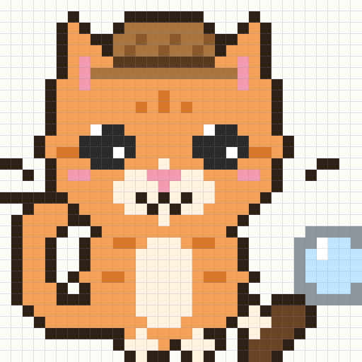

# Watchcat — Quantum Simulation Companion

Watchcat is a research companion for dissipative bosonic quantum simulations. Its
deterministic core checks whether a simulation is numerically trustworthy for
declared observables, compares Fock-space truncations, and recommends a
validated configuration. The pet UI is represented by a custom pixel-art
detective cat: Watchcat investigates suspicious simulation results and reacts
to the evidence.

## Meet Watchcat

<p align="center">
  
</p>

Watchcat combines a friendly virtual pet with a serious numerical trust layer:

- the detective cat watches Alice & Bob cat-qubit simulations;
- worried expressions flag possible truncation or accuracy problems;
- happy and celebrating expressions appear after validated convergence checks;
- the scientific result always comes from measured diagnostics, never from the
  cat's mood.

The current mascot is a hand-built pixel-art cat rendered on a canvas. It will
become the visual layer for Watchcat's states: sleeping, watching, worried,
happy, and celebrating.

## Current status

The first vertical slice is dependency-free and includes:

- a serializable simulation-run contract;
- edge-population, trace, precision, and photon-number diagnostics;
- observable-aware convergence comparisons;
- measured-runtime-aware configuration recommendations;
- a demo report and unit tests.

The demo uses synthetic trajectories only to test the Watchcat contract. It is
not a physics result. A Dynamiqs adapter for the Alice & Bob cat-qubit model is
included, but executing it requires Dynamiqs/JAX to be installed.

## Run the smoke test

```bash
python3 -m unittest discover -s tests -v
python3 -m qpet.demo
```

The generated `qpet_demo_report.json` is a local artifact and is ignored by
Git.

## Planned layers

1. Run and validate the Dynamiqs adapter on the Alice & Bob Introductory Track.
2. Wigner, parity, fidelity, purity, and partial-trace diagnostics.
3. VS Code pet panel consuming Watchcat JSON artifacts.
4. Optional sponsor integrations: Gemini explanations, Backboard memory,
   Tiger Data experiment history, remote Vultr sweeps, and ElevenLabs voice.
