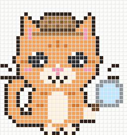

# Watchcat Expression States

Watchcat is the pixel-art detective cat that lives alongside the quantum
simulation. Its expressions make the numerical results easy to notice, while
the actual scientific decision always comes from Watchcat's measured
diagnostics.

## Idle — current look

  

The idle look is Watchcat calmly investigating with its magnifying glass. The
full idle animation is the supplied
[`pixel_detective_cat_idle_animation.html`](</Users/summermalik/Downloads/pixel_detective_cat_idle_animation.html>): it loops through blinking, eye movement, tail movement, gentle bobbing, and a magnifying-glass movement.

## Planned expression states

| State | What Watchcat looks like | When it appears |
| --- | --- | --- |
| **Idle** | Calm detective cat with a magnifying glass | No simulation is running |
| **Watching** | Focused cat actively investigating | A simulation is running |
| **Worried** | Concerned cat with a warning message | A truncation, trace, or accuracy check looks unreliable |
| **Happy** | Smiling cat with a green validation badge | The result passes the requested checks |
| **Celebrating** | Excited cat with sparkles or a reward | A cheaper validated configuration is found |
| **Sleeping** | Eyes closed and magnifying glass lowered | Watchcat is inactive for a while |

## Important design rule

An expression is a communication layer, not a scientific measurement. Watchcat
will always show the numerical evidence next to the animation, including the
tested truncation, observable differences, tolerance, runtime, and validation
result.

## Implementation status

- **Idle animation:** designed and implemented in the supplied HTML file and exported as [`assets/watchcat-idle.gif`](assets/watchcat-idle.gif) for Markdown previews.
- **Static README artwork:** available at [`assets/watchcat.svg`](assets/watchcat.svg).
- **Simulation-driven expressions:** next integration step for the Watchcat UI.
